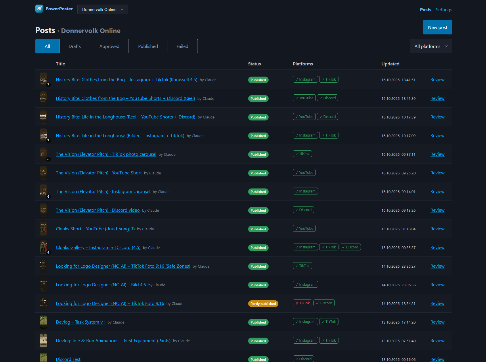
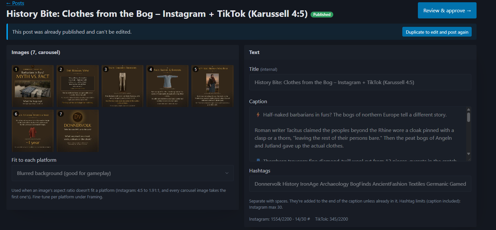
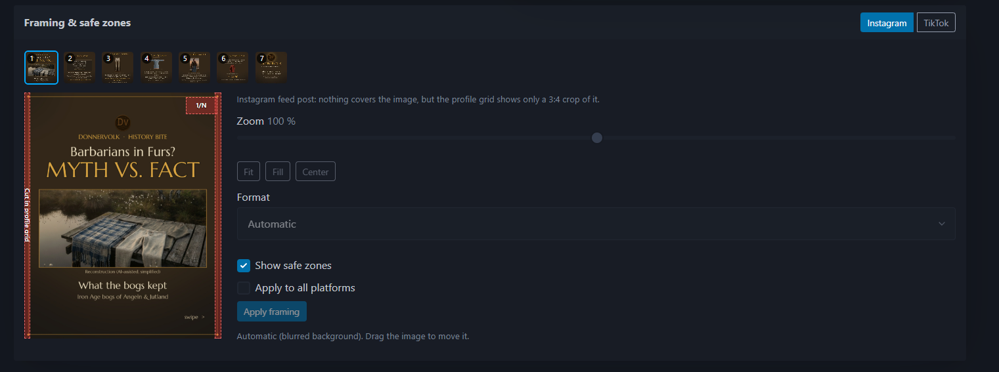
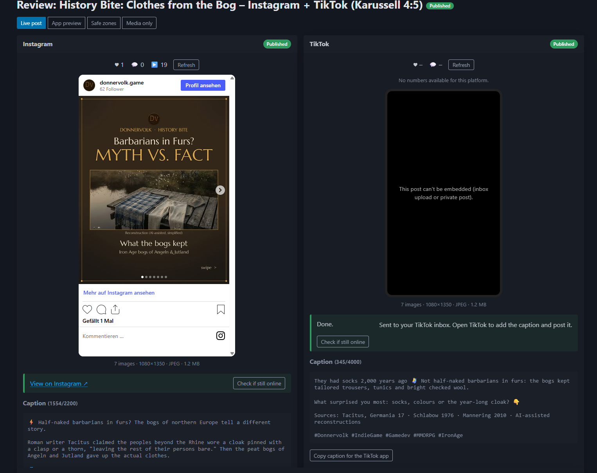

# PowerPoster

Write **one post** with a video or images, let PowerPoster convert it for every platform, **review** exactly what will be uploaded, then **publish** to Instagram (Reels, image and carousel posts), TikTok (videos and photo posts), YouTube (Shorts) and Discord. Claude can prepare posts for you through **MCP**.

- **One post, many platforms** — shared caption and hashtags, with per-platform overrides and options.
- **Projects** — one per game or brand, each with its own brand profile, defaults for new posts and platform accounts. Switch projects in the header.
- **Platform rules built in** — caption length, hashtag and mention limits (e.g. Instagram 30 hashtags, TikTok 5, YouTube 60) and each platform's required settings are checked before you can approve.
- **Automatic conversion** — 4K/120 fps gameplay becomes 1080×1920 H.264 at ≤60 fps with a blurred background, crop, or black bars. Platforms that need the same file share one encode.
- **Image posts** — one image, or several as a carousel. Each image is converted to the format and aspect ratio every platform accepts (e.g. JPEG between 4:5 and 1.91:1 for Instagram), PNGs stay lossless where the platform takes them.
- **Draft → Review → Publish** — approval is tied to the exact content. Change anything afterwards and the post goes back to draft.
- **Claude integration** — an MCP server lets Claude create drafts, attach videos and check them. By default only you can publish.
- **Pluggable platforms** — each platform is one Go package (`internal/platform/<name>`).
- **Local first** — a single Go binary with SQLite and FFmpeg. Nothing leaves your machine except the uploads to the platforms.

---

## Showcase

**Posts** — every post of the current project with its status per platform.



**Post editor** — images or video, caption and hashtags with live limits per platform.



**Framing & safe zones** — fine-tune the crop per platform and see what the app UI covers.



**Review** — the live post, stats and caption side by side for every platform.



---

## Quick start (Docker)

You only need [Docker Desktop](https://www.docker.com/products/docker-desktop/).

```bash
cp .env.example .env
```

Open `.env` and set `INBOX_HOST_PATH` to the absolute path of the `inbox` folder in this repo, for example `C:/Development/power-poster/inbox`. Then start it:

```bash
docker compose up -d --build
```

Open **http://127.0.0.1:4000**.

That's all you need to create posts, upload videos or images, watch them get converted and review them. To actually publish, connect your accounts (see [Connecting platforms](#connecting-platforms)).

Useful commands:

| What | Command |
|---|---|
| Follow the logs | `docker compose logs -f powerposter` |
| Stop | `docker compose down` |
| Stop and **delete all data** | `docker compose down -v` |
| Start with the HTTPS tunnel | `docker compose --profile tunnel up -d` |
| Use an NVIDIA GPU for encoding | `docker compose -f compose.yaml -f compose.gpu.yaml up -d --build` |

Data (database, converted videos, the token encryption key) lives in the Docker volume `powerposter-data`.

---

## Running locally without Docker

**Requirements:** Go 1.26+, Node.js 22+, FFmpeg (`winget install Gyan.FFmpeg` on Windows, `brew install ffmpeg` on macOS, `apt install ffmpeg` on Debian/Ubuntu).

Build the UI once, then start the server:

```bash
npm --prefix web ci
```

```bash
npm --prefix web run build
```

```bash
go run ./cmd/powerposter
```

Open **http://127.0.0.1:4000**. The server reads `.env` from the current folder if one exists. Data goes to `./data` and the drop folder is `./inbox`.

### Developing the UI with hot reload

Run the Go server and the Vite dev server side by side:

```bash
go run ./cmd/powerposter
```

```bash
npm --prefix web run dev
```

Open **http://localhost:5173**. Vite forwards `/api`, `/media` and `/mcp` to the Go server. Add `PP_BASE_URL=http://localhost:5173` to `.env` so that review links (and the redirect after connecting an account) open the dev UI.

### Tests

```bash
go test ./...
```

```bash
npm --prefix web run typecheck
```

The Go tests run real FFmpeg conversions when FFmpeg is installed, and skip those tests otherwise. Instagram, TikTok, YouTube, Discord and MCP are tested against local fake servers.

---

## How it works

```
 Draft ──(media converted, no errors)──► Approve ──► Publish ──► Published
   ▲                                          │                     (per platform)
   └──────────── any change after approval ───┘          └──► Failed → Retry
```

1. **Create a post.** Write the caption and hashtags, then pick the platforms. The editor shows each platform's caption and hashtag limits (e.g. at most 5 hashtags on TikTok).
2. **Add a video or images.** A post has either one video or images; adding a video replaces images and the other way round. It's converted for each platform right away:

   | Video problem | What PowerPoster does |
   |---|---|
   | 4K / 1440p | Scales to 1080×1920 |
   | 16:9 gameplay for a 9:16 reel | Blurred background (default), center crop, or black bars |
   | 120/144 fps | 60 fps |
   | VP9, ProRes, 10-bit, MKV… | H.264 (yuv420p) in MP4 |
   | 96 kHz, Opus, 5.1 audio | AAC 48 kHz stereo |
   | Bitrate or file too large | Re-encodes with a capped bitrate |
   | Slow-start MP4 | Moves the index to the front (`+faststart`) |
   | Too long | **Error**: trim the video yourself, PowerPoster won't cut your content |

   **Images** (JPEG, PNG or WebP) are added in order; several images become a carousel. Reorder or remove them in the editor. Per platform:

   | | Instagram | TikTok (photo post) | Discord |
   |---|---|---|---|
   | Images per post | 1–10 | 1–35 | 1–10 |
   | Format | JPEG | JPEG or WebP | JPEG, PNG or WebP (PNG stays lossless) |
   | Size | 1080 px wide | fits 1080×1920 | fits 4096×4096 |
   | Aspect ratio | 4:5 to 1.91:1; every carousel image takes the first one's | any | any |
   | Upload | downloads from a public link (needs the tunnel) | downloads from a public link (needs the tunnel and a verified domain) | direct upload, up to `DISCORD_MAX_UPLOAD_MB` per message |

   Images outside a platform's aspect ratio are fitted with the same choice as videos: blurred background (default), crop, or black bars. The first image is the one shown first, so put the strongest one first.

   **Framing & safe zones.** Below the media, you can place the video (or each image) by hand for every platform: drag it, zoom with the slider or mouse wheel, with that platform's safe zones drawn on top (Reels, TikTok and YouTube Shorts cover different areas, TikTok photos more than videos). Images can also get another format per platform, e.g. 9:16 for a full-screen TikTok photo. "Apply to all platforms" uses the same framing everywhere; "Back to automatic" drops it. Framing re-converts only the affected platform.

3. **Pick a cover** (videos only). Choose a frame of the video (used by Instagram and TikTok), or upload an image. Instagram uses the image (needs the tunnel); TikTok's API only accepts a video frame; YouTube picks the Shorts thumbnail itself. Image posts have no separate cover: the first image is it.
4. **Review.** Phone-sized previews play the converted files (image posts as a swipeable carousel) inside an approximation of each app: Reels, TikTok and YouTube Shorts UI on top of videos and TikTok photos, the Instagram feed around image posts. The safe-zone mode shows each platform's covered areas (for Instagram image posts: the 3:4 crop of the profile grid). You see the final caption for each platform, every automatic fix, and any remaining problems.
5. **Approve.** This locks in the content. Any change afterwards (caption, options, video, images or their order) sends the post back to draft. The internal title doesn't count.
6. **Publish** each platform on its own card, or all at once. Uploads run in the background. Each platform shows its progress, the link to the live post, or an error with a **Retry** button. Once a post is live, the review page shows its likes, comments and views, and its *Live* mode embeds the real post (Instagram, public TikTok posts, YouTube). If you delete a post on the platform, the review page notices it (status *Removed*); you can then edit the post and publish it again.

---

## Projects

Each game or brand is a **project**. Every post belongs to one project, and each project has its own:

- **Brand profile** (game name, link, default hashtags, tone notes) that Claude uses for captions,
- **defaults for new posts** (platforms, how video is fitted to 9:16),
- **platform accounts**: connect a different Instagram account, TikTok account, YouTube channel and Discord channel per project.

Pick the project in the header; the post list and *Settings → Project* follow it. Add, rename or delete (empty) projects under *Settings → Projects*. App credentials in `.env` (Meta app, TikTok app, Google OAuth client) are shared by all projects: add each project's Instagram account as a tester of the same Meta app, and each TikTok account as a target user of the same TikTok app.

When connecting the account of a second project, sign out of the first account on the platform's website (or use a private window) first, otherwise the platform signs you straight back in with the old account.

Existing data from before projects were added becomes the first project, named after the game name in your brand profile.

## Using it with Claude (MCP)

PowerPoster serves MCP (Streamable HTTP) at `http://127.0.0.1:4000/mcp`. To connect Claude Code:

```bash
claude mcp add --transport http powerposter http://127.0.0.1:4000/mcp
```

Then ask, for example:

> Make a 30-second reel for donnervolk-online from `inbox/raid.mp4` for Instagram and TikTok, write an English caption in the project's brand voice and give me the review link.

> Post the three screenshots `inbox/biome-1.png` to `biome-3.png` as a carousel on Instagram and Discord, with a short caption about the new biome.

| Tool | What it does |
|---|---|
| `list_projects` | Shows the projects with brand profile, default platforms and connected accounts |
| `list_platforms` | Shows platforms, a project's connection status, option schemas and the inbox folder |
| `get_platform_constraints` | Returns the limits for video posts (resolution, fps, duration, size) and image posts (formats, aspect ratio, size, images per post), plus caption limits |
| `create_post` | Creates a draft in a project (its hashtags and default platforms apply). `project` can be left out while there is only one project. Whether it's a video or an image post follows from the attached media |
| `attach_media` | Attaches one video, or one or more images (`paths`, in carousel order), by path. The paths **must be inside the inbox folder**. Images are added to the existing ones unless `replace` is set |
| `upload_media` | Sends a small video or image (≤ 50 MB) as base64, for files outside the inbox |
| `remove_media` / `reorder_media` | Remove an image, or set the order of the images |
| `update_post` / `set_target_options` | Edit caption, hashtags, fill mode, cover frame and per-platform settings |
| `set_cover_image` | Custom cover image for video posts (Instagram) |
| `duplicate_post` | Copies a post (with its media and conversions) into a new draft |
| `validate_post` | Returns errors, warnings, automatic fixes, conversion progress and whether the post is ready |
| `get_post` / `list_posts` / `get_review_link` | Read the state of posts |
| `publish_post` | Publishes **approved** posts only, and only if you enabled it (see below) |
| `get_publish_status` / `get_post_stats` | Shows progress, links and errors per platform; likes, comments and views of published posts |

Resources: `powerposter://brand` (game name, link, hashtags, tone notes of every project) and `powerposter://platforms/<id>/constraints` (video and image limits).

**Inbox folder:** Claude passes paths as it sees them on your machine (`C:\…\power-poster\inbox\clip.mp4`), and PowerPoster maps them to its own view (`/inbox/clip.mp4` in Docker). Point `INBOX_HOST_PATH` at the folder where your video and image tools already save their output, and nothing needs copying.

**Publishing from Claude** is off by default: Claude prepares the post and you approve and publish it on the review page. Under *Settings → Claude (MCP)* you can allow Claude to publish posts **you have approved**. Claude can never approve a post itself.

---

## Connecting platforms

Instagram and TikTok need an **HTTPS** redirect URL for signing in. PowerPoster has a second, internal listener (port 4001) that serves *only* the OAuth callbacks, signed media links and three static pages for the platforms' app forms: an info page (`/`, the *website URL*), `/terms` and `/privacy`. Set `PP_LEGAL_OPERATOR` and `PP_LEGAL_CONTACT` so they name you. Only that listener is exposed through a tunnel; the UI, the API and MCP stay on your machine.

### 1. Tunnel

**ngrok (easiest, free, no own domain):**

1. Create an account on [ngrok.com](https://ngrok.com), claim your free static domain under *Domains* (e.g. `name.ngrok-free.dev`), install ngrok (`winget install ngrok.ngrok`) and run `ngrok config add-authtoken <token>` once.
2. In `.env` set `NGROK_DOMAIN=name.ngrok-free.dev`.
3. Start PowerPoster as usual. It starts ngrok itself, forwards `https://name.ngrok-free.dev` to the callback listener (port 4001), uses it as `PUBLIC_BASE_URL`, and stops ngrok on exit. Don't run ngrok by hand at the same time.
   In Docker, also set `NGROK_AUTHTOKEN` in `.env` and run `docker compose --profile ngrok up -d`.

After a platform sign-in, the free ngrok plan shows a warning page once. Click **Visit Site** to continue.

**Or Cloudflare (own domain):**

1. In the Cloudflare dashboard go to *Zero Trust → Networks → Tunnels* and create a tunnel. Copy its **token**.
2. Add a *public hostname*, e.g. `pp.yourstudio.com`, with service **`http://powerposter:4001`** (Docker) or **`http://localhost:4001`** (native run).
3. In `.env`, set the following and start with the tunnel profile:

   ```dotenv
   PUBLIC_BASE_URL=https://pp.yourstudio.com
   TUNNEL_TOKEN=<token>
   ```

   ```bash
   docker compose --profile tunnel up -d
   ```

   Native run: `cloudflared tunnel run --token <token>`.

Settings shows the exact redirect URI to register for each platform: `<PUBLIC_BASE_URL>/oauth/<platform>/callback`.

### 2. Instagram

Requires an Instagram **Professional** account (Business or Creator). No Facebook Page is needed.

**Quickest way, no tunnel needed:** in your Meta app go to *Instagram → API setup with Instagram login → Generate access tokens*, add your Instagram account (it must accept the tester invite), click *Generate token*, and paste it in PowerPoster under *Settings → Instagram → Or paste an access token*. The token lasts 60 days and is refreshed automatically while PowerPoster is running.

**Image posts** (single images and carousels) always need the tunnel, whichever way you connect: Instagram has no upload for images and downloads them from a public link.

**Or with OAuth (Connect button):**

1. Go to [developers.facebook.com](https://developers.facebook.com/apps) → *Create app* → pick the Instagram use case that offers the **Instagram API with Instagram Login** (dashboard names change from time to time).
2. Under *Instagram → API setup with Instagram login*:
   - Add the permissions `instagram_business_basic` and `instagram_business_content_publish`.
   - Set the redirect URI to `https://pp.yourstudio.com/oauth/instagram/callback`.
   - Add your Instagram account as an **Instagram tester** under *App roles* and accept the invite in Instagram (*Settings → Apps and websites*).
3. Copy the **Instagram app ID** and **app secret** into `INSTAGRAM_APP_ID` and `INSTAGRAM_APP_SECRET`, restart, then click **Connect** in Settings.

The app can stay in development mode for your own accounts; no App Review is needed. Tokens last 60 days, and PowerPoster refreshes them automatically while it's running.

### 3. TikTok

1. Go to [developers.tiktok.com](https://developers.tiktok.com/) → *Manage apps* → create an app. Add the products **Login Kit** and **Content Posting API**.
2. Add the scopes `user.info.basic`, `video.upload` and `video.publish`, and register the redirect URI shown in PowerPoster's Settings:
   - **Without a tunnel:** in Login Kit choose the **Desktop** platform and register `http://localhost:4000/oauth/tiktok/callback`. PowerPoster uses this automatically when `PUBLIC_BASE_URL` is empty.
   - **With a tunnel:** `https://pp.yourstudio.com/oauth/tiktok/callback` (Web platform).
   - Until TikTok reviews the app, use **Sandbox** mode and add your TikTok account as a **target user**.
3. Copy the **client key** and **client secret** into `TIKTOK_CLIENT_KEY` and `TIKTOK_CLIENT_SECRET`, restart, then click **Connect**.

Things to know about TikTok:
- **Posting mode:**
  - **Inbox** (the default): the video goes to your TikTok inbox and you add the caption and post it in the TikTok app. TikTok doesn't accept a caption for inbox uploads, so the review page has a *Copy caption* button.
  - **Direct**: posts right away. Until TikTok audits your app, direct posts are **private** (and need a private account). Apply for the audit in the developer portal to post publicly.
- **Required settings:** TikTok requires an explicit visibility choice (there is no default), the comment/Duet/Stitch toggles, and a commercial-content disclosure. Ads for your own game count as *"Your brand"*, labelled "Promotional content". The editor and review page show all of these.
- **Hashtags:** at most 5 per post (videos and photo posts). The editor and the default hashtags under *Settings → Project* show the limit; posts with more don't pass validation.
- **Music:** neither TikTok nor Instagram offers licensed sounds through their API, so bake the music into the video.
- **Photo posts:** TikTok only downloads photos from a public link whose URL you verified, so they need the tunnel plus a one-time verification of the tunnel address:
  1. In the developer portal open your app → *Verify properties* (*URL properties*) → **URL prefix**, and enter the tunnel address with a trailing slash, e.g. `https://name.ngrok-free.dev/`. A free ngrok domain can only be verified this way (there is no DNS access).
  2. Download the signature file TikTok offers and save it into the `verify` folder inside the inbox (`inbox/verify/`). PowerPoster serves `.txt` files (and Google Search Console's `google<hash>.html`) from that folder, and nothing else from the inbox, at the root of the tunnel.
  3. Click *Verify*. The publish error names the exact prefix TikTok expects.

  The caption is sent as the photo description (up to 4000 characters), also in inbox mode. *Add recommended music* lets TikTok pick a sound for direct photo posts.

### 4. YouTube

PowerPoster uploads to YouTube with the YouTube Data API v3. There is no separate Shorts API: a vertical video of up to 3 minutes becomes a Short automatically, and PowerPoster always delivers 1080×1920.

1. In the [Google Cloud Console](https://console.cloud.google.com/) create a project and enable the **YouTube Data API v3** (*APIs & Services → Library*).
2. *Google Auth Platform*:
   - **Branding:** app name, support e-mail, and the tunnel's home page, `/privacy` and `/terms` URLs. Google wants the home page domain verified: add it as a **URL prefix** property in the [Search Console](https://search.google.com/search-console), choose *HTML file*, and save the `google<hash>.html` file into `inbox/verify/` (served at the tunnel root, like TikTok's file).
   - **Data access:** add the scopes `youtube.upload` and `youtube.readonly`.
   - **Audience:** user type *External*, then **Publish app** (*In production*). In *Testing*, Google expires the sign-in after 7 days. Unverified apps show an "app not verified" warning when connecting; for your own account you can continue past it.
   - **Clients:** create an OAuth client of type *Web application* and register the redirect URI shown in PowerPoster's Settings, `https://<tunnel>/oauth/youtube/callback` (and `http://localhost:4000/oauth/youtube/callback` for runs without a tunnel).
3. Copy the client ID and secret into `YOUTUBE_CLIENT_ID` and `YOUTUBE_CLIENT_SECRET`, restart, then click **Connect** and pick the account (or brand account) that owns the channel.

Things to know about YouTube:
- **Audit:** uploads from Google Cloud projects that haven't passed the YouTube API audit are **locked as private**, and can't be made public afterwards. Apply with the *YouTube API Services – Audit and Quota Extension* form; until then, use YouTube for testing only. The review page shows a note when a video was locked.
- **Title and description:** the caption becomes the description (up to 5000 characters; YouTube ignores all hashtags if there are more than 60). The title is an option on the post; left empty, it's the first line of the caption, cut to 100 characters. YouTube rejects `<` and `>` in both.
- **Required settings:** visibility, *Made for kids* (required by law), category (default *Gaming*), *Notify subscribers*, and the label for altered or synthetic content.
- **Cover:** YouTube picks the Shorts thumbnail; the API can't set it. Change it in the YouTube app if needed.
- **Quota:** a project gets 10,000 API units per day, and each upload costs about 1,600, so about 6 uploads per day. The quota resets at midnight Pacific time; more can be requested with the audit form.
- **Stats:** views, likes and comments come from the video's statistics. Deleting the video on YouTube shows the post as *Removed*.

### 5. Discord

Discord needs no app, no tunnel and no sign-in: PowerPoster posts through a **channel webhook**.

1. In Discord, right-click the channel → *Edit Channel* → *Integrations* → *Webhooks* → *New Webhook*. Its name and avatar are what the posts show as author. Then *Copy Webhook URL*.
2. In PowerPoster: *Settings → Project → Connections → Discord*, paste the URL and click **Save**. Each project can post to its own channel.

Things to know about Discord:
- **Upload limit:** Discord only accepts files up to the server's limit: 10 MB without boosts, 50 MB at boost level 2, 100 MB at level 3. PowerPoster compresses the video to fit `DISCORD_MAX_UPLOAD_MB` (default 10) and warns on the review page when that makes it blurry. Shorter clips look better.
- **Images:** up to 10 per message, shown as a gallery. PNG, JPEG and WebP are uploaded as they are (PNG stays lossless); only images larger than 4096 px or the upload limit are converted. All images of a post together must fit `DISCORD_MAX_UPLOAD_MB`.
- **Notify:** per post, choose to ping nobody (default), `@here` or `@everyone`. Mentions written in the caption never ping.
- **Forum channels** need a *Forum post title* (an option on the post); text channels leave it empty.
- **Stats:** likes are the emoji reactions on the message, comments are replies in a thread started from it. Deleting the message in Discord shows the post as *Removed*.
- The webhook URL is a secret: anyone who has it can post to the channel. PowerPoster stores it encrypted. If it leaks, delete the webhook in Discord and paste a new one.

---

## Configuration

All settings are environment variables, read from `.env` (native) or passed in by `compose.yaml` (Docker).

| Variable | Default | Purpose |
|---|---|---|
| `INBOX_HOST_PATH` | — | (Docker) Absolute host path of the inbox folder; mounted to `/inbox` and used to translate Claude's paths |
| `PP_PORT` | `4000` | (Docker) Port on 127.0.0.1 for the UI, API and MCP |
| `POWERPOSTER_SECRET_KEY` | generated | Key that encrypts platform tokens (base64, 32 bytes). If empty, one is generated into `<data>/secret.key`. Create one with `powerposter keygen` |
| `NGROK_DOMAIN` | — | ngrok static domain; PowerPoster starts ngrok and uses it as `PUBLIC_BASE_URL` |
| `NGROK_AUTOSTART` | `true` | Set to `false` to run ngrok yourself (Docker sets this) |
| `PUBLIC_BASE_URL` | — | HTTPS URL of the tunnel, used for OAuth redirect URIs |
| `TUNNEL_TOKEN` | — | Cloudflare tunnel token (Docker `tunnel` profile) |
| `PP_LEGAL_OPERATOR` / `PP_LEGAL_CONTACT` | — | Operator name and contact e-mail on the public info, terms and privacy pages |
| `INSTAGRAM_APP_ID` / `INSTAGRAM_APP_SECRET` | — | Meta app credentials |
| `INSTAGRAM_API_VERSION` | `v23.0` | Instagram Graph API version |
| `TIKTOK_CLIENT_KEY` / `TIKTOK_CLIENT_SECRET` | — | TikTok app credentials |
| `YOUTUBE_CLIENT_ID` / `YOUTUBE_CLIENT_SECRET` | — | Google Cloud OAuth client (Web application) for YouTube |
| `DISCORD_MAX_UPLOAD_MB` | `10` | Upload limit of your Discord server(s) in MB (10, 50 or 100); videos are compressed to fit |
| `FFMPEG_ENCODER` | `libx264` | `libx264` (CPU) or `h264_nvenc` (NVIDIA) |
| `MAX_PARALLEL_ENCODES` | `1` | Number of conversions that run at the same time |
| `FFMPEG_PATH` / `FFPROBE_PATH` | `ffmpeg` / `ffprobe` | Paths to the binaries if they aren't on `PATH` |
| `PP_DATA_DIR` | `./data` | Database, media files and key |
| `PP_INBOX_DIR` | `./inbox` | Drop folder, as this process sees it |
| `PP_PRIVATE_ADDR` | `127.0.0.1:4000` | Listener for the UI, API and MCP |
| `PP_PUBLIC_ADDR` | `127.0.0.1:4001` | Listener for OAuth callbacks (the tunnel's target) |
| `PP_BASE_URL` | `http://127.0.0.1:4000` | How your browser reaches the UI (used in review links and after connecting an account) |

---

## Project layout

```
cmd/powerposter/        entry point: serve | keygen | healthcheck
internal/
  app/                  use cases: posts, conversion, validation, approval, publishing, connections
  config/               environment variables and .env loading
  api/                  REST API, media files, web UI, OAuth callbacks, security middleware
  mcpserver/            MCP tools and resources for Claude
  media/                ffprobe, conversion planner for videos and images, ffmpeg runner
  platform/             adapter interface, caption rules, registry
    instagram/          Instagram Reels (resumable upload), image and carousel posts
    tiktok/             TikTok Content Posting API (chunked upload, inbox/direct, photo posts)
    youtube/            YouTube Shorts (Google OAuth, resumable upload, processing status)
    discord/            Discord channel webhook (multipart upload, several files)
  jobs/                 background job queue (stored in SQLite, survives restarts)
  store/                SQLite schema and queries
  secret/               AES-GCM token encryption
  tunnel/               ngrok autostart for the public listener
  webui/                built UI (embedded with -tags embedui)
web/                    React + Vite + Pico CSS
docs/logo/              logo source images
```

### Adding a platform

1. Create `internal/platform/<name>/` with a type that implements `platform.Adapter` (`internal/platform/platform.go`):
   - `SupportedKinds` and `Constraints`: which post kinds the platform takes (`video`, `image`) and their media and caption limits, as data. The converter and validation use them automatically.
   - `OptionsSchema`: a JSON Schema for platform settings. The UI form and the MCP tool input are generated from it.
   - `Validate` and `ReviewNotices`: rules and texts specific to the platform.
   - `Auth()`: the OAuth flow. Platforms without OAuth implement `TokenImporter` and `TokenPrompter` (with `Only: true`) instead, like Discord's webhook URL.
   - `Publish`: the upload, which blocks until the platform reports success or failure.
2. Register it in `cmd/powerposter/main.go` (`platform.NewRegistry(...)`).
3. Add tests against an `httptest` fake server, like `internal/platform/tiktok/tiktok_test.go`.

Nothing else needs to change: the UI, the MCP tools, conversion and review pick up the new platform.

---

## Troubleshooting

| Symptom | Fix |
|---|---|
| "FFmpeg is required…" in the log, or *System → FFmpeg* shows an error | Install FFmpeg, or set `FFMPEG_PATH` and `FFPROBE_PATH` |
| Claude gets "outside the inbox folder" | Save the file into the inbox folder. In Docker, check that `INBOX_HOST_PATH` is the absolute host path |
| "PUBLIC_BASE_URL is not set" when connecting | Set up the tunnel ([Connecting platforms](#connecting-platforms)) |
| The sign-in page says the redirect URI doesn't match | Register exactly the URI shown in Settings |
| "cannot decrypt token" | `POWERPOSTER_SECRET_KEY` changed. Set the old key back, or reconnect the accounts |
| Port 4000 is busy | Docker: set `PP_PORT`. Native: set `PP_PRIVATE_ADDR` and `PP_BASE_URL` |
| A publish was interrupted by a restart | It's marked as failed. Check the platform before clicking *Retry*: the post may already be live |
| Image post: "downloads images from a public link" | Instagram and TikTok fetch images themselves: set up the tunnel ([Connecting platforms](#1-tunnel)) |
| TikTok photo post fails with `url_ownership_unverified` | Verify the tunnel address as a URL prefix in the TikTok developer portal (see [TikTok](#3-tiktok) → Photo posts) |
| YouTube video is private although *Public* was chosen | The Google Cloud project hasn't passed the YouTube API audit yet (see [YouTube](#4-youtube)) |
| YouTube: `quotaExceeded` | The project's daily API quota is used up. Wait until midnight Pacific time, or request more with the audit form |
| YouTube sign-in fails with "needs both permissions" | Connect again and leave both boxes on Google's consent screen checked |
| Instagram: "API access blocked (code 200)" | Meta rejects every call of the connected account, not just this post. Check the Meta app dashboard for alerts or restrictions and the Instagram app for notices about the account, then reconnect Instagram |

## Roadmap

Planned next: a history view grouped by platform, scheduling, more platforms (X, Bluesky, Threads) and metrics over time.
